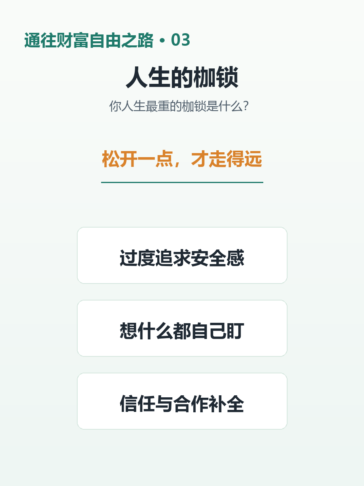
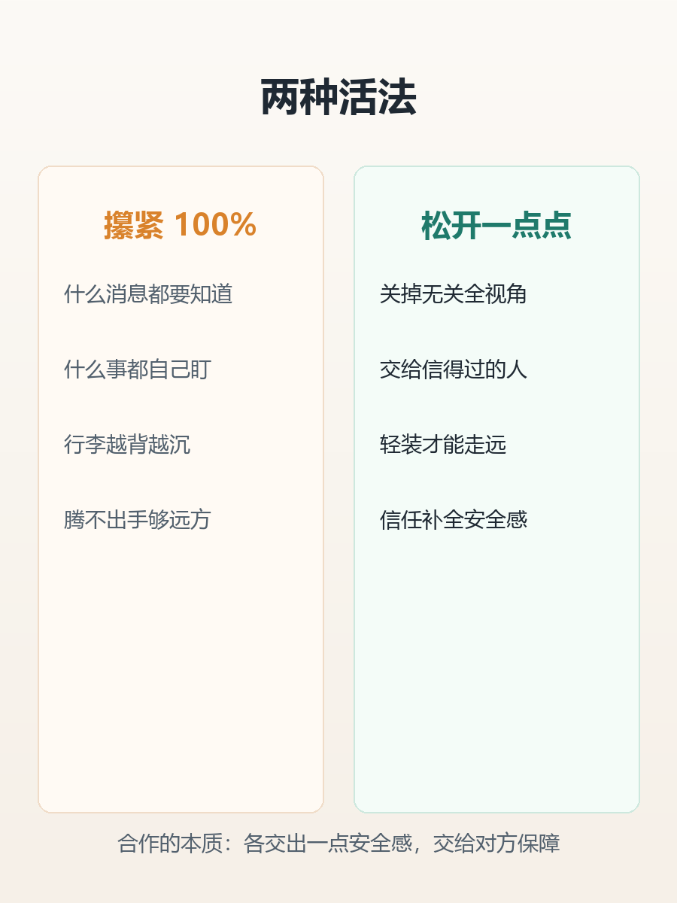

# 把钥匙全攥在手里的人，走不远

> 备选标题一：你背了太多"以防万一"
> 备选标题二：松开一点点，反而更稳

**摘要：** 我们总想把每件事都握在手里才安心。可握得越紧，往往越走不动。这周聊一个反常识的真相：真正困住人的，常常是那份"百分百的安全感"。松开一点点，天不会塌。

最安全的人，常常走得更慢。

有个画面我一直记得：那种出门把所有东西都塞进背包的人——牙刷、常用药、备用电池、雨衣，连应急干粮都备上三份。他不是爱囤货，只是不放心把任何一件事交给"说不定路上会有"。结果别人轻装往前走，他弯着腰，每一步都踩得沉沉的。

李笑来把这种状态叫"人生的枷锁"，而最重的那一把，就是对百分之百安全感的执着。什么消息都要知道、什么事都自己盯，看似稳妥，其实把自己钉在了原地——因为你腾不出手，去够更远的地方。

想起一位制造企业的人事负责人，团队就五个人，公司正从松散走向规范。起初她什么都亲自把关，连一份通知的措辞都要过目。后来她试着把几件事真正交出去，信任同事去完成。奇妙的是，团队慢慢长大了，她反倒轻松了。

安全感不是攥得越紧就越多。你把一部分交给可信的人，它就变成了合作，变成了信任，也变成了别人成长的空地。

不用一次松开很多。今天就试试：把一件"非我不可"的小事，交给一个你信得过的人。你会发现，天没塌，心里反而亮了一点。

